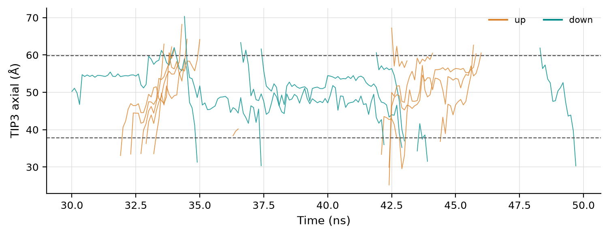
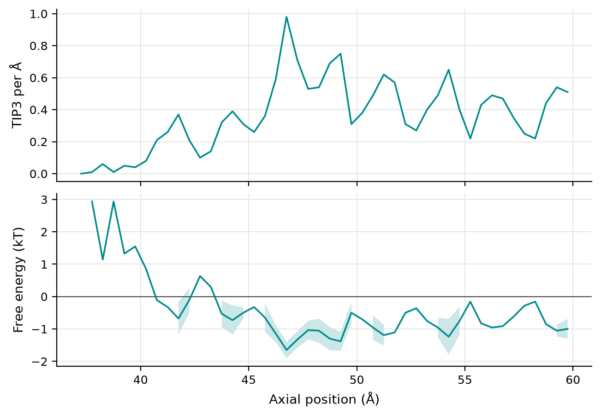

# Water through an aquaporin: AQP4 permeation

This example counts water molecules crossing the pore of human aquaporin-4
(AQP4) in a membrane simulation, and derives the two permeabilities that
describe a water channel: the diffusive permeability **pd**, from the rate of
complete crossings, and the osmotic permeability **pf**, from the collective
motion of the water inside the pore. It takes a few seconds.

The commands and numbers below were run with CREVICE {{ version }} on the
excerpt; this page is not executed when the documentation is built.

## Download the excerpt

The full simulation is 100 ns of one AQP4 monomer in a lipid bilayer with
19,373 waters, saved every 100 ps. Crossings need consecutive frames, so the
example keeps 200 of them (30 to 50 ns), with the protein, the lipid
phosphorus atoms, the ions and the 3,093 waters that come near the pore
(about 10 MB to download):

```bash
crevice fetch --example aqp4-excerpt
cd ~/.cache/crevice/examples/aqp4-excerpt
```

`aqp4_excerpt_README.md` describes the system and exactly which waters were
kept. For channels inside that region, such as the one below, the counts are
the same as those of the full simulation over the same frames.

```bash
crevice trajectory --topology aqp4_excerpt.gro --inspect aqp4_excerpt.xtc
```

```text
topology	aqp4_excerpt.gro
trajectory	aqp4_excerpt.xtc
selection	protein
total_atom_count	13031
selected_atom_count	3351
selected_residue_count	223
frame_count	200
time_step_ps	100.0
total_time_ps	19900.0
box_dimensions	[99.63494873046875, 99.63494873046875, 98.32466125488281, 90.0, 90.0, 90.0]
has_elements	False
has_chain_ids	False
segment_ids	['SYSTEM']
```

## Place the channel

The water pathway runs along z, through the two Asn-Pro-Ala (NPA) motifs and
the aromatic/arginine filter. In this build the water line lies about 3 Å to
one side of the centroid of the two NPA asparagines (Asn97 and Asn213,
residues 66 and 182 of the simulation), so the channel point is that centroid
shifted onto the line, measured in the first frame:

```python
import MDAnalysis as mda

u = mda.Universe("aqp4_excerpt.gro", "aqp4_excerpt.xtc")
npa = u.select_atoms("resid 66 182 and name ND2").positions.mean(axis=0)  # Asn97, Asn213
point = npa + (1.156, 2.824, 0.0)  # onto the pore-water line
print("point", point.round(3), "extent", round(point[2] - 12, 3), round(point[2] + 10, 3))
```

```text
point [52.776 52.439 49.835] extent 37.835 59.835
```

The channel is a cylinder of radius 3 Å around the line through that point,
from 12 Å below it (the cytoplasmic mouth) to 10 Å above it (past the filter).
All channel coordinates refer to the first frame; every frame is fitted to it
on the protein's CA atoms.

## Count the crossings

```bash
crevice trajectory aqp4_excerpt.xtc --topology aqp4_excerpt.gro --permeation-only \
    --permeation TIP3,SOD,CLA --axis z --channel-extent 37.835,59.835 --channel-radius 3 \
    --origin 52.776,52.439,49.835 --temperature 310 --outputs data,figures -o run/aqp4.json
```

```text
permeation channel TIP3: up=9 down=6 unresolved=0 mean_inside=8.39 pd=1.13e-14 pf=4.45e-14 cm3/s
permeation channel SOD: up=0 down=0 unresolved=0 mean_inside=0
permeation channel CLA: up=0 down=0 unresolved=0 mean_inside=0
permeation channel ion current=0 pA conductance undefined (no voltage)
trajectory permeation-only output=run/aqp4.json
```

Fifteen waters crossed the whole pore in 19.9 ns, 9 upwards and 6 downwards,
with on average 8.4 waters inside the cylinder. No ion entered it, as
expected for a water-selective channel. `run/aqp4_permeation_events.csv`
lists each crossing (molecule, direction, entry and exit frame, transit time),
and `run/aqp4_permeation.json` holds the full summary.

From the summary (`channels[0].species[0].water`):

| Quantity | Value | 95 % interval |
| --- | --- | --- |
| pd (cm³/s) | 1.13 × 10⁻¹⁴ | 0.59–1.96 × 10⁻¹⁴ |
| pf (cm³/s) | 4.45 × 10⁻¹⁴ | 1.01–7.89 × 10⁻¹⁴ |
| pf/pd | 4.0 | |

With so few crossings the intervals are wide, and 20 ns cannot say more than
the order of magnitude. pf larger than pd is what a single-file pore gives:
water molecules cannot pass each other, so a net flow moves the whole file
while a single molecule must wait for its neighbours to make room. See
[Permeation and conductance](../tools/permeation.md) for how both are defined
and how their intervals are computed.

## The crossings, one by one



`run/aqp4_permeation_positions.png` draws the axial position of each water
that crossed, from the bulk frame before it entered to the bulk frame after
it left; orange traces went up, teal ones down, and the dashed lines are the
two ends of the channel. Ten of the fifteen crossings take 0.8 to 1.8 ns from
entry to exit; the slowest take over 5 ns. Several waters sit in the pore for
nanoseconds at about the same heights before moving on: the water file moves
as a whole.

## Where the water sits



`run/aqp4_permeation_profile.png` shows the number of waters per Å along the
pore (top) and the free energy obtained from it (bottom, in kT; in kcal/mol
in the CSV because `--temperature` was given), with its interval where the
data allow one. Density is low near the cytoplasmic end, where the cylinder
leaves the narrow pore, and peaks inside it at preferred water positions. The
free energy is a Boltzmann inversion of the density: it assumes equilibrium,
which holds here (no applied field), and it is not corrected for the
cross-section of the pore.

## From Python

```python
import MDAnalysis as mda
from crevice.permeation import CylinderChannel, analyze_permeation, write_permeation_outputs

u = mda.Universe("aqp4_excerpt.gro", "aqp4_excerpt.xtc")
point = u.select_atoms("resid 66 182 and name ND2").positions.mean(axis=0) + (1.156, 2.824, 0.0)
pore = CylinderChannel("pore", (0, 0, 1), point[2] - 12, point[2] + 10, point=tuple(point), radius=3.0)
result = analyze_permeation(u, species=["TIP3"], channels=[pore], temperature_K=310)
water = result.summary["channels"][0]["species"][0]
print(water["events_up"], water["events_down"], water["water"]["pd_cm3_per_s"], water["water"]["pf_cm3_per_s"])
write_permeation_outputs(result, "run_py", prefix="aqp4")
```

## Things to try

- Change `--channel-radius` (2 to 4 Å) or the extent and watch the counts:
  the definition of the channel decides what a crossing is.
- `--permeation-convention strict` counts only uninterrupted passages through
  the lumen.
- An extent that follows the membrane (`--membrane-planes "name P"`) reaches
  into the wide pore mouths, about 20 Å either side of the pore point. The
  excerpt does not keep the waters there, so that definition needs the full
  simulation.
