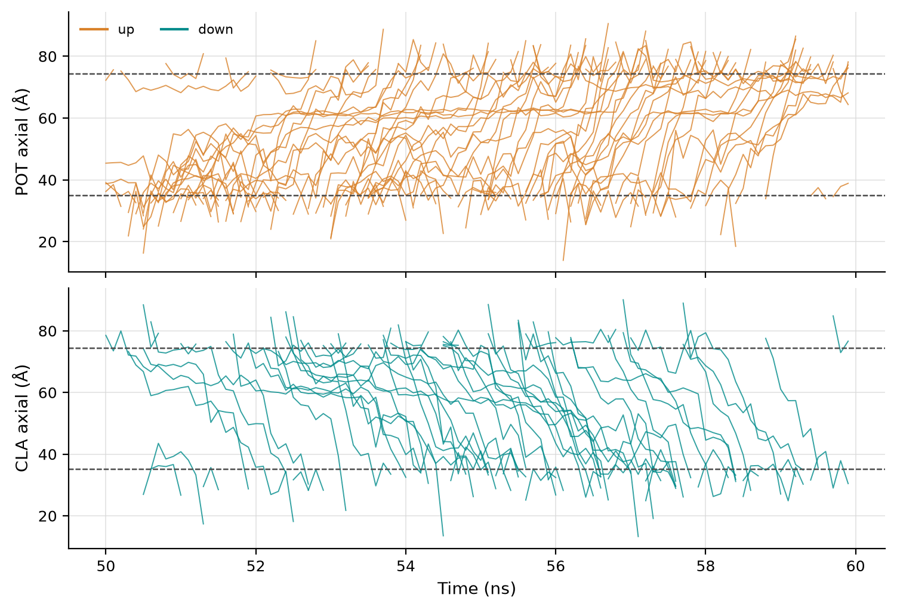
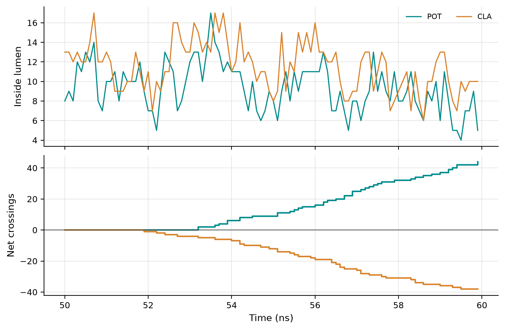

# Ions through a porin: OmpF current and conductance

This example counts potassium and chloride ions crossing the three pores of
the bacterial porin OmpF in a simulation with an applied electric field, and
turns the counts into an ionic current and a conductance for each pore. It
takes a few seconds.

The commands and numbers below were run with CREVICE {{ version }} on the
excerpt; this page is not executed when the documentation is built.

## Download the excerpt

The full simulation is 100 ns of the OmpF trimer in a lipid bilayer, in 1 M
KCl, with a static field of 0.05 V/nm along z, saved every 100 ps. The
example keeps 100 consecutive frames (50 to 60 ns) with the protein, the
lipid phosphorus atoms and every ion, plus the run's `.mdp` file (about 7 MB
to download):

```bash
crevice fetch --example ompf-excerpt
cd ~/.cache/crevice/examples/ompf-excerpt
```

`ompf_excerpt_README.md` describes the system. Because every ion is kept, the
ion counts are the same as those of the full simulation over the same frames.
Water was left out, so water permeation needs the full simulation.

## Place the three pores

Each OmpF monomer has its own pore, constricted halfway through the membrane
by a cluster of arginines. The centroid of the CZ atoms of Arg42, Arg82 and
Arg132 of each chain gives a point on that pore's axis. The excerpt numbers
the residues through the three chains (chain 2 starts at 341), so:

```python
import MDAnalysis as mda

u = mda.Universe("ompf_excerpt.gro", "ompf_excerpt.xtc")
for chain in range(3):  # Arg42, Arg82 and Arg132 of each chain: the constriction of one pore
    resids = " ".join(str(r + 340 * chain) for r in (42, 82, 132))
    point = u.select_atoms(f"resid {resids} and name CZ").positions.mean(axis=0)
    print(f"--permeation-pore={point[0]:.3f},{point[1]:.3f},{point[2]:.3f}")
```

```text
--permeation-pore=66.587,55.513,61.557
--permeation-pore=81.043,76.310,61.203
--permeation-pore=55.220,77.257,61.070
```

## Count the ions and compute the current

```bash
crevice trajectory ompf_excerpt.xtc --topology ompf_excerpt.gro --permeation-only \
    --permeation POT,CLA --axis z --membrane-planes "name P" --channel-radius 8 \
    --permeation-pore=66.587,55.513,61.557 --permeation-pore=81.043,76.310,61.203 \
    --permeation-pore=55.220,77.257,61.070 \
    --efield-from ompf_excerpt_production.mdp --temperature 310 --outputs data,figures -o run/ompf.json
```

```text
crevice: warning: 166 transits through the axial extent never entered the lumen of the channel they were counted for (listed as outside_lumen, not counted); check the lateral radius or region, or whether they passed another pore
permeation pore1 POT: up=18 down=0 unresolved=0 mean_inside=3.62 outside_lumen=27
permeation pore1 CLA: up=0 down=9 unresolved=0 mean_inside=4.29 outside_lumen=29
permeation pore1 ion current=437 pA conductance=778 pS
permeation pore2 POT: up=26 down=0 unresolved=0 mean_inside=3.33 outside_lumen=18
permeation pore2 CLA: up=0 down=10 unresolved=0 mean_inside=4.12 outside_lumen=28
permeation pore2 ion current=583 pA conductance=1.04e+03 pS
permeation pore3 POT: up=0 down=0 unresolved=0 mean_inside=2.4 outside_lumen=45
permeation pore3 CLA: up=0 down=19 unresolved=0 mean_inside=3.11 outside_lumen=19
permeation pore3 ion current=307 pA conductance=548 pS
trajectory permeation-only output=run/ompf.json
```

What the options do:

- `--membrane-planes "name P"` makes each pore's axial extent follow the
  bilayer: in every frame it runs from the mean height of the lower leaflet's
  phosphorus atoms to that of the upper leaflet's (here 35.2 and 74.8 Å on
  average, a bilayer 39.6 Å thick). A crossing is then a passage from one side
  of the membrane to the other.
- `--channel-radius 8` is the lateral radius of each pore's lumen around the
  line through its point, along `--axis z`.
- `--efield-from` reads the applied field from the `.mdp` file. The voltage is
  the field times the mean box height of the frames read: 0.05 V/nm ×
  11.23 nm = 561 mV, positive driving cations upwards.

Every crossing went the way the field drives it: potassium up, chloride
down. From the summary (`channels[i].ion_current_total`), with intervals from
the spread of the net charge over 10 time blocks:

| Pore | K⁺ up | Cl⁻ down | Current (pA) | 95 % interval | Conductance (pS) |
| --- | --- | --- | --- | --- | --- |
| 1 | 18 | 9 | 437 | 164–710 | 778 |
| 2 | 26 | 10 | 583 | 283–883 | 1038 |
| 3 | 0 | 19 | 307 | 169–446 | 548 |

Together the three pores carry 1.33 nA, 2.4 nS at 561 mV. Ten nanoseconds
give a few dozen crossings per pore, so the pores differ by more than their
real differences: pore 3 passed no potassium in this window. Longer runs
narrow the intervals (see [Permeation and conductance](../tools/permeation.md)
for the 100 ns run of this system).

**The warning.** An ion that crosses the membrane through one pore also
crosses the extent of the other two, outside their lumens. Those passages are
listed as `outside_lumen` and not counted. Here 164 of the 166 are ions that
crossed through another pore at the same time; two crossed the membrane
without entering any of the three lumens.

## The crossings, one by one



`run/ompf_permeation_positions.png` draws the axial position of every ion
that crossed any of the three pores, potassium (top) and chloride (bottom),
from the bulk frame before it entered to the bulk frame after it left; the
dashed lines are the membrane planes. Half of the crossings take less than
1.4 ns from entry to exit, and nine in ten less than 3 ns; many ions pause
at about 60 Å, the height of the arginine clusters.



`run/ompf_permeation.png` shows, for the three pores together, how many ions
of each kind are inside the lumens (top) and the cumulative net crossings
(bottom). The steady staircases are the current. The first crossing
completes 1.9 ns into the excerpt: ions already inside a pore at the start
are not counted, because their entry was not seen, and new ones take a
nanosecond or more to cross.

The axial density of each ion is in `run/ompf_permeation_profile.csv`, but
no free energy is derived from it here: with an applied field the system is
driven out of equilibrium, so CREVICE withholds it.

## From Python

```python
import MDAnalysis as mda
from crevice.permeation import CylinderChannel, analyze_permeation, read_applied_field

u = mda.Universe("ompf_excerpt.gro", "ompf_excerpt.xtc")
pores = []
for chain in range(3):
    resids = " ".join(str(r + 340 * chain) for r in (42, 82, 132))
    point = u.select_atoms(f"resid {resids} and name CZ").positions.mean(axis=0)
    pores.append(CylinderChannel(f"pore{chain + 1}", (0, 0, 1), None, None, point=tuple(point), radius=8.0,
                                 membrane="name P"))
field = read_applied_field("ompf_excerpt_production.mdp")  # E_V_per_nm (x, y, z), static, source
result = analyze_permeation(u, species=["POT", "CLA"], channels=pores,
                            efield=field["E_V_per_nm"], efield_source=field["source"])
for pore in result.summary["channels"]:
    print(pore["ion_current_total"]["current_pA"], pore["ion_current_total"]["conductance_pS"])
```

## Things to try

- `--channel-radius 6` or `10`: 79 and 82 crossings in all (82 at 8 Å); the
  lumen radius changes the attribution to pores more than the total.
- An explicit extent instead of the membrane planes, for example
  `--channel-extent 46.277,76.277` (15 Å either side of the arginine
  clusters).
- `--voltage 561` gives the voltage directly instead of the field.
