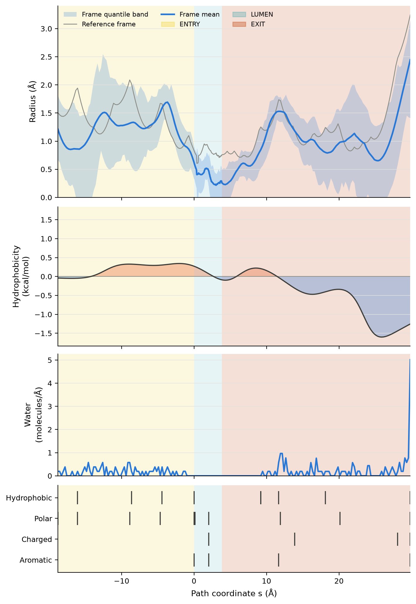

# Pore fingerprints: 1GRM, 3UKM and a GLUT1 trajectory

This tutorial runs [`crevice fingerprint`](../tools/fingerprint.md) on three
inputs and shows how to read the results. The numbers are geometric
measurements under the stated settings. They are not validated biology, and
the conductance is an order-of-magnitude estimate, not a measurement.

## 1GRM: gramicidin A

```bash
crevice fingerprint 1GRM --axis auto --out-dir 1GRM_fp --prefix 1GRM
crevice fingerprint 1GRM --axis auto --electrolyte kcl-1m --out-dir 1GRM_fp_1M --prefix 1GRM
```

```text
fingerprint samples=95 lining_residues=32 segments=entry_1,lumen,exit_1 g_macro_pS=61 (kcl-150mm; geometric estimate)
fingerprint samples=95 lining_residues=32 segments=entry_1,lumen,exit_1 g_macro_pS=363 (kcl-1m; geometric estimate)
```


The lumen is 23.3 Å long and its minimum radius is 1.32 Å. Both ends are
open, so short straight vestibules (ENTRY and EXIT) continue out to bulk. All
32 residues of the dimer line the path, and the hydrophobicity profile is
positive almost everywhere. The scale assigns values per residue, but
gramicidin's lumen is actually lined by backbone carbonyl oxygens, so this
profile describes the residues, not the chemistry of the lumen surface.

In 1 M KCl, *G*<sub>macro</sub> is 363 pS, and 65 pS after HOLE's empirical
divisor. Measured gramicidin A conductances in 1 M salt are about 10–30 pS.
The estimate is therefore an overestimate, as expected for a continuum model
of a single-file pore.

## 3UKM: a channel with a capped end

```bash
crevice fingerprint 3UKM --assembly 1 --exclude-hetero --lateral-exits --enclosure-radius 0.55 \
    --out-dir 3UKM_fp --prefix 3UKM
```


The lower end is capped. The widest of its two lateral exit legs (17.0 Å)
becomes EXIT at negative *s*. The second leg (16.2 Å, same bottleneck) is
listed under `exit_legs` in the JSON with `on_path: false`. The straight
vestibule at the open upper end is ENTRY. The narrow selectivity-filter lumen
(minimum radius 0.62 Å) gives *G*<sub>macro</sub> ≈ 32 pS in 150 mM KCl.
The lumen has 19 lining residues: 6 hydrophobic, 8 polar, 2 aromatic and 7
Gly (counted as `other`). Its mean hydrophobicity is slightly negative
(−0.18 kcal/mol). Because of `--exclude-hetero`, the bound undecane molecules
are not counted as lining.

## GLUT1 excerpt: a trajectory with water

```bash
crevice fetch-example glut1-excerpt
cd ~/.cache/crevice/examples/glut1-excerpt
crevice fingerprint glut1_excerpt.gro --trajectory glut1_excerpt.xtc \
    --selection 'protein and not name H*' --axis z --lateral-exits --enclosure-radius 0.55 \
    --out-dir glut1_fp --prefix glut1
```



GLUT1 is a transporter, not a channel. With the automatic probe ladder no
stable channel resolves, so the probe is fixed at 0.55 Å. At that probe the
first frame has a short lumen (3.8 Å) with both ends capped, and each end
leaves sideways through one exit leg (18.8 Å and 26.0 Å). Over the 21 frames
the clearance at this fixed reference path is zero somewhere in the lumen in
9 frames. The per-frame *G*<sub>macro</sub> ranges from 0 to 94 pS, with a
median of 0.9 pS: the narrow route seen in the first frame is mostly closed
later.

Water oxygens appear along both exit legs but never in the lumen. The spike
at the far end is the bulk-facing sample, where the free sphere is large.
These are observations of a narrow geometric route under one probe setting.
They say nothing about substrate transport.

:::{admonition} Interpreting the results
:class: crevice-interpret

The three fingerprints are readings of geometry and residue identity under
the settings shown, not functional results. Gramicidin A's lumen is lined by
backbone carbonyls of residues the scale calls hydrophobic, so the
hydrophobicity curve there describes side chains, not the wall water sees.
The conductance values are order-of-magnitude geometric estimates, about
10–40 times above gramicidin A's measured conductance, and GLUT1's numbers
depend on the fixed 0.55 Å probe. The
[method note](../methods/fingerprint.md) lists every definition and
limitation.
:::

To get a fingerprint with every other output of a structure, add
`--fingerprint` to [`crevice publish`](../tools/publish.md); to look at the
same channel in 3D, run [`crevice view`](../tools/view.md) on the output
directory.
