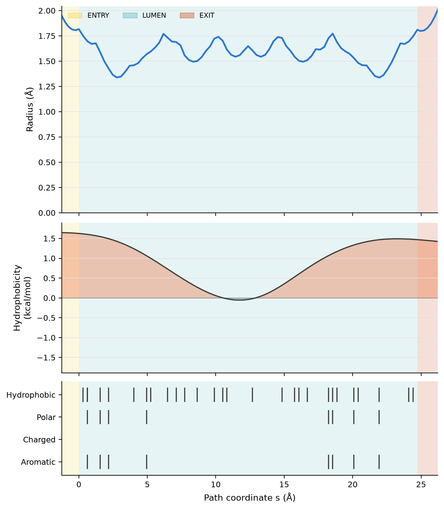
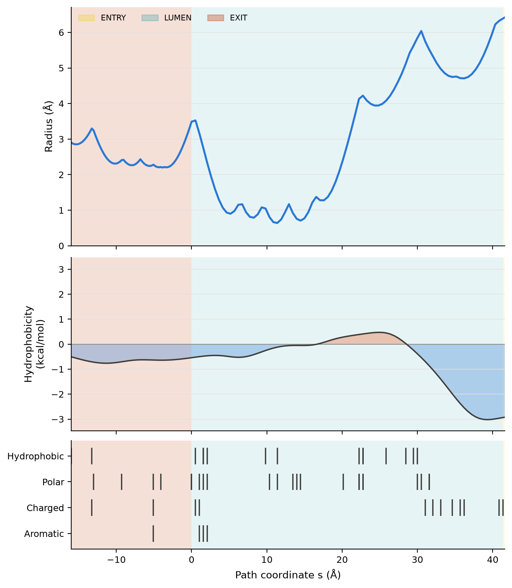
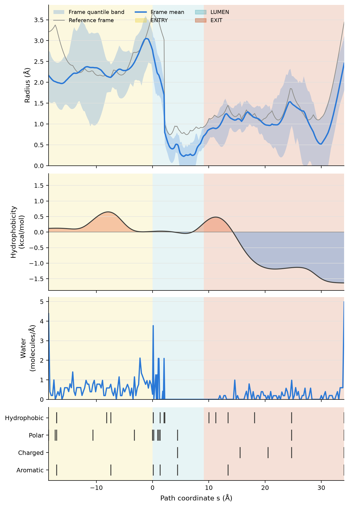

# Pore fingerprints: 1GRM, 3UKM and a GLUT1 trajectory

This tutorial runs [`crevice profile --fingerprint`](../tools/fingerprint.md) on three
inputs and shows how to read the results. The numbers are geometric
measurements under the stated settings. They are not validated biology, and
the conductance is an order-of-magnitude estimate, not a measurement.

## 1GRM: gramicidin A

```bash
crevice profile --fingerprint 1GRM --axis auto --out-dir 1GRM_fp --prefix 1GRM
crevice profile --fingerprint 1GRM --axis auto --electrolyte kcl-1m --out-dir 1GRM_fp_1M --prefix 1GRM
```

```text
fingerprint samples=92 lining_residues=32 segments=entry_1,lumen,exit_1 g_macro_pS=58.7 (kcl-150mm; geometric estimate)
wrote 1GRM_fingerprint.csv, 1GRM_fingerprint.json, 1GRM_fingerprint.png to 1GRM_fp
fingerprint samples=92 lining_residues=32 segments=entry_1,lumen,exit_1 g_macro_pS=349 (kcl-1m; geometric estimate)
wrote 1GRM_fingerprint.csv, 1GRM_fingerprint.json, 1GRM_fingerprint.png to 1GRM_fp_1M
```



The lumen is 24.7 Å long and its minimum radius is 1.34 Å. Both ends are
open, so short straight vestibules (ENTRY and EXIT) continue out to bulk. All
32 residues of the dimer line the path, and the hydrophobicity profile is
positive everywhere except a short stretch at the centre, where it dips just
below zero. The scale assigns values per residue, but
gramicidin's lumen is actually lined by backbone carbonyl oxygens, so this
profile describes the residues, not the chemistry of the lumen surface.

In 1 M KCl, *G*<sub>macro</sub> is 349 pS, and 62 pS after HOLE's empirical
divisor. Measured gramicidin A conductances in 1 M salt are about 10–30 pS.
The estimate is therefore an overestimate, as expected for a continuum model
of a single-file pore.

## 3UKM: a channel with a capped end

```bash
crevice profile --fingerprint 3UKM --assembly 1 --exclude-hetero --lateral-exits \
    --out-dir 3UKM_fp --prefix 3UKM
```



```text
fingerprint samples=147 lining_residues=57 segments=entry_1,lumen,exit_1 g_macro_pS=29.7 (kcl-150mm; geometric estimate)
```

The default probe gives the two-portal profile of the
[3UKM tutorial](3ukm-lateral-exits.md): the lower end is capped and placed
where the side portals branch off, and the lumen runs from there through the
selectivity filter and the wide upper vestibule to the open upper end. The
first-ranked of the two lateral exit legs (16.0 Å, bottleneck 2.20 Å) becomes
EXIT at negative *s*. The second leg (15.1 Å, bottleneck 2.17 Å; legs are
ranked by their width beyond the mouth) is listed under `exit_legs` in the
JSON with `on_path: false`. The upper end opens straight into bulk, so its
ENTRY segment has no length; it lists the six charged residues at that mouth
(E269, K274 and R277 of both subunits). The 41.4 Å lumen (minimum radius
0.64 Å, in the filter) gives *G*<sub>macro</sub> ≈ 30 pS in 150 mM KCl. The
lumen has 51 lining residues; counted by class (a residue can be in more than
one), 14 are hydrophobic, 22 polar, 11 charged, 4 aromatic and 8 Gly (counted
as `other`). Its mean hydrophobicity is negative (−0.53 kcal/mol). Because of
`--exclude-hetero`, the bound undecane molecules are not counted as lining.

## GLUT1 excerpt: a trajectory with water

```bash
crevice fetch --example glut1-excerpt
cd ~/.cache/crevice/examples/glut1-excerpt
crevice profile --fingerprint glut1_excerpt.gro --trajectory glut1_excerpt.xtc \
    --selection 'protein and not name H*' --axis z --lateral-exits --enclosure-radius 0.55 \
    --out-dir glut1_fp --prefix glut1
```



```text
fingerprint samples=261 lining_residues=36 segments=entry_1,lumen,exit_1 g_macro_pS=58.5 (kcl-150mm; geometric estimate) frames=21 g_macro_median_pS=3.27
```

GLUT1 is a transporter, not a channel, and this example fixes the probe at
0.55 Å. With the default per-slice probe, `crevice profile glut1_excerpt.gro
--md-selection 'protein and not name H*' --axis z --lateral-exits` follows a
longer, wider route instead (t = −20.0 to +12.7 Å, minimum radius 1.32 Å), so
the probe is part of the result. At 0.55 Å the first frame has a short lumen (9.1 Å, minimum radius
0.74 Å) with both ends capped, and each end leaves sideways through one exit
leg (18.5 Å with a 2.12 Å bottleneck, and 25.0 Å with a 0.93 Å bottleneck).
Over the 21 frames the clearance at this fixed reference path is zero
somewhere in the lumen in 8 frames. The per-frame *G*<sub>macro</sub> ranges
from 0 to 59 pS (the first frame), with a median of 3.3 pS: the narrow route
seen in the first frame is often closed later.

Water oxygens appear along both exit legs and in the first 2 Å of the lumen,
next to the lower leg, but not in its narrow middle. The spikes at the two far
ends are the bulk-facing samples, where the free sphere is large.
These are observations of a narrow geometric route under one probe setting.
They say nothing about substrate transport.

:::{admonition} Interpreting the results
:class: crevice-interpret

The three fingerprints are readings of geometry and residue identity under
the settings shown, not functional results. Gramicidin A's lumen is lined by
backbone carbonyls of residues the scale calls hydrophobic, so the
hydrophobicity curve there describes side chains, not the wall water sees.
The conductance values are order-of-magnitude geometric estimates, about
10–40 times above gramicidin A's measured conductance, and GLUT1's numbers
depend on the fixed 0.55 Å probe. The
[method note](../methods/fingerprint.md) lists every definition and
limitation.
:::

To get a fingerprint with every other output of a structure, add
`--fingerprint` to [`crevice report`](../tools/publish.md); to look at the
same channel in 3D, run [`crevice view`](../tools/view.md) on the output
directory.
