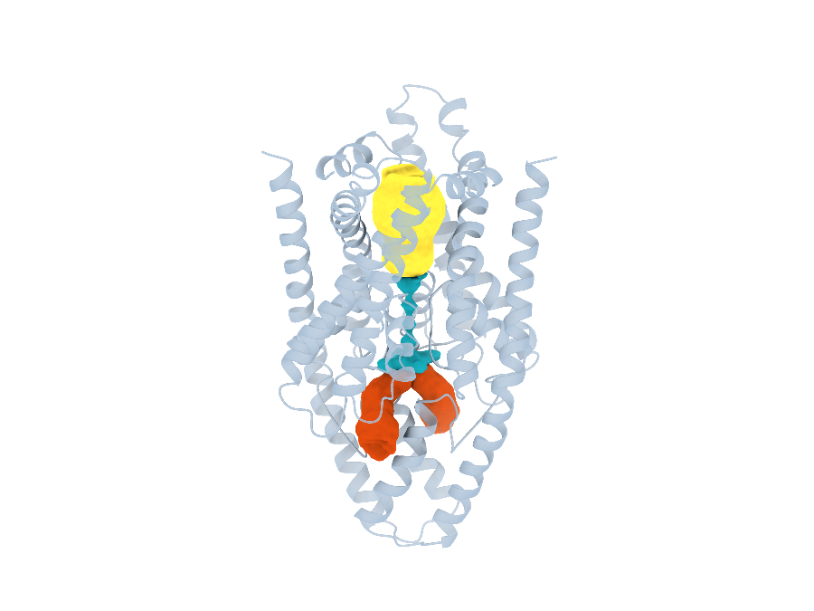
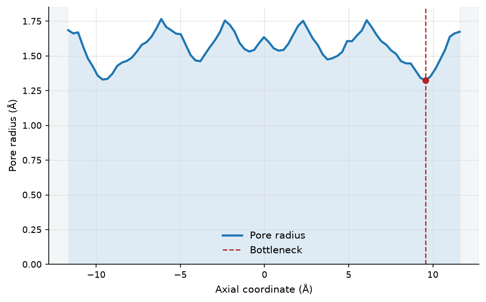
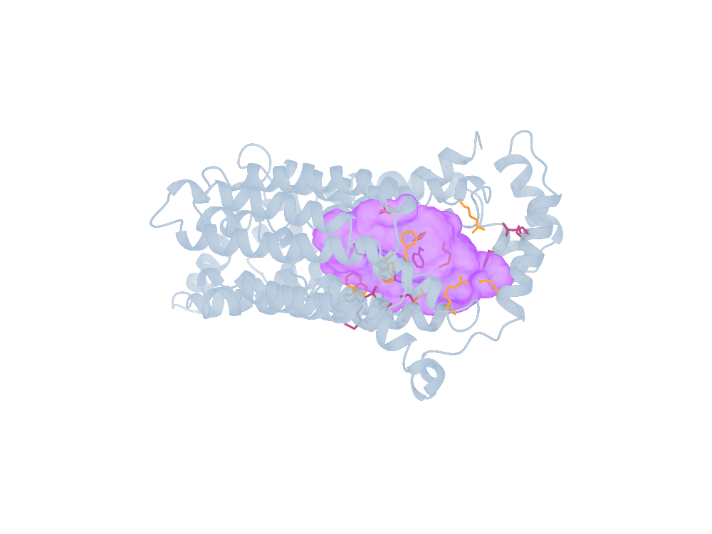
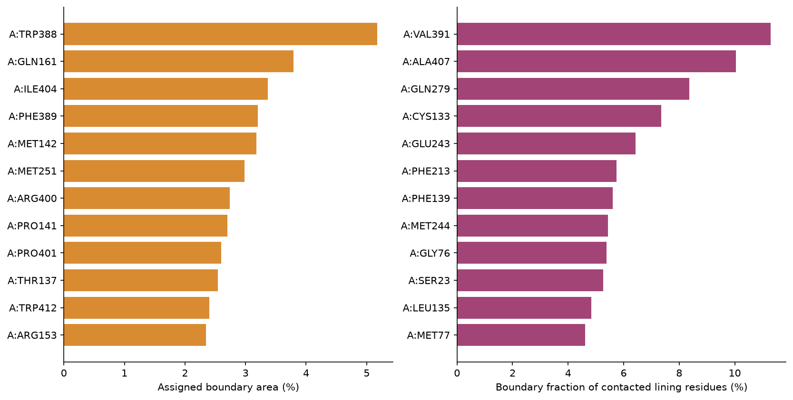
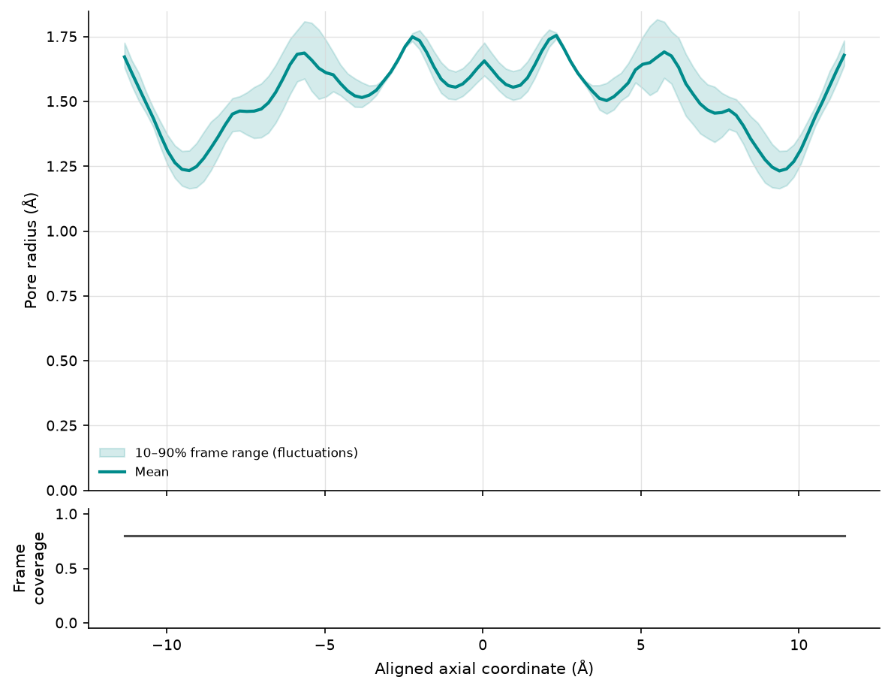
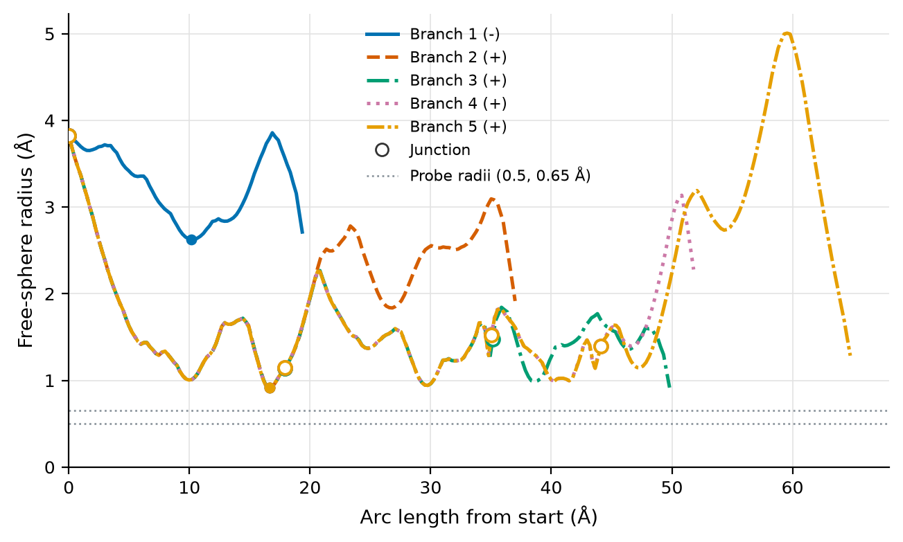
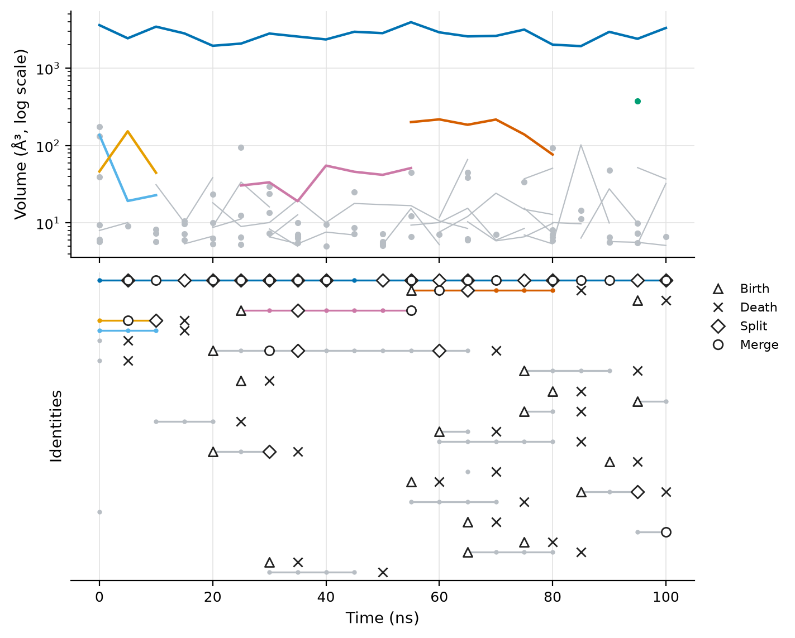
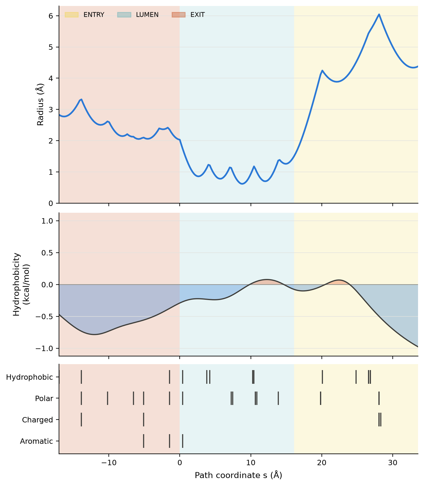
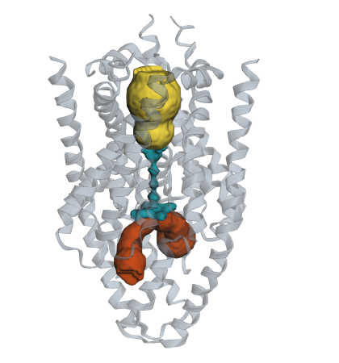

# CREVICE

::::{container} crevice-hero

:::{container}
**CREVICE** finds and measures the spaces inside proteins: the pores and
channels that run through them, the cavities buried within them and the
tunnels that lead out. It tells you which residues line those spaces, which
residues they touch, and where the water is, for a single structure or across a
whole molecular-dynamics trajectory.

```bash
pip install crevice
crevice publish 1GRM --out-dir results/1GRM
```
:::



::::

{{ full_name }} is a Python package and a command-line tool. Everything it
does can be run as a `crevice` command or called from Python, and every result
comes as tables you can analyse, figures you can publish and scenes you can
open in PyMOL, VMD or ChimeraX, or explore in your web browser.

## Your first analysis

Measure the gramicidin A channel in one command. CREVICE downloads the
structure for you:

```bash
crevice publish 1GRM --out-dir results/1GRM --prefix 1GRM
```

```text
publish files=40 out_dir=results/1GRM profile=resolved
```

`results/1GRM` now holds 40 files:
the main results and nothing you didn't ask for.

- **tables (CSV)**: the radius at every point along the channel
  (`1GRM_profile.csv`), the residues around it (`1GRM_residue_contacts.csv`),
  the residues lining each part of the cast (`1GRM_lining_residues.csv`), the
  cast and its entry, lumen and exit segments, and the typed residue
  interactions (hydrogen bonds, salt bridges, aromatic contacts);
- **two figures**: the radius profile and the residue contacts;
- **3D scenes** for PyMOL, VMD and ChimeraX (`1GRM_volume.pml`, `.vmd`,
  `.cxc`) with the maps they load;
- a **manifest** (`1GRM_manifest.json`) listing every file and every setting.

Want more? `--outputs default,hydration` adds the water analyses, `--all`
writes everything (cavities, tunnels, the residue network, every figure, a
pore fingerprint and an interactive HTML view), and `--dry-run` shows what a
command would do without running it. [Outputs](getting-started/outputs.md)
has the full list.

Just the profile is one line too, and so is the same thing in Python:

```bash
crevice profile 1GRM -o 1GRM_profile.json --png 1GRM_profile.png
```

```text
profile points=81 min_radius=1.324 mean_radius=1.563 bottleneck_index=73
enclosure_radius=0.750 (auto: smallest probe of channel group 1, which resolved at 5 of 21 probes tried)
```

```python
import crevice

frame = crevice.load_structure(".crevice/pdb/1GRM.cif")
profile = crevice.pore_profile(frame)
print(f"narrowest point: {profile.min_radius:.2f} Å")
```

[Basic usage](getting-started/basic-usage.md) walks through this and a few
more first steps. Coming from 0.2? [Upgrading to 0.3](getting-started/upgrading-0.3.md)
shows how to get the old files back.

## What can it do?

::::{container} crevice-cards

:::{container} crevice-card


**[Pores and channels](tools/profile.md)**

Radius profiles along a channel and 3D casts of the space inside it.
:::

:::{container} crevice-card crevice-violet


**[Cavities and tunnels](tools/cast.md)**

Casts of pockets and buried cavities, and the widest routes to the outside.
:::

:::{container} crevice-card crevice-entry


**[Residues and networks](tools/residue-evidence.md)**

Which residues form a boundary, and who they talk to.
:::

:::{container} crevice-card crevice-exit


**[Trajectories](tools/trajectory.md)**

Follow a channel, a cavity or its water through every frame of a simulation.
:::

:::{container} crevice-card crevice-entry


**[Curved and branched pathways](tools/paths.md)**

The widest routes from a site to the solvent, however they bend, with the
junctions where they split.
:::

:::{container} crevice-card crevice-violet


**[Cavity tracking](tools/cavity-tracking.md)**

Give every cavity an identity across a simulation, and see where they appear,
vanish, split and merge.
:::

:::{container} crevice-card


**[Pore fingerprints](tools/fingerprint.md)**

Radius, lining hydrophobicity, chemistry and water along one channel, with a
rough conductance estimate.
:::

:::{container} crevice-card crevice-violet


**[Interactive 3D views](tools/view.md)**

Turn any result into a 3D view in Jupyter or one offline HTML file you can
share.
:::

::::

Browse all of them in [Analysis tools](tools/index.md), or learn by example in
the [Tutorials](examples/index.md).

:::{admonition} New in 0.3
:class: tip

- **Compact outputs.** Commands now write the data, the key figures and
  PyMOL, VMD and ChimeraX scenes by default (a 1GRM `publish` writes 40 files
  instead of 96, with the same numbers). Ask for more with `--outputs` or
  `--all`, preview a run with `--dry-run`, and save and reuse settings with
  `--print-config` and `--config`. See [Outputs](getting-started/outputs.md)
  and [Upgrading to 0.3](getting-started/upgrading-0.3.md).
- **Curved and branched pathways.** `crevice paths` follows the widest routes
  from a site to the solvent without assuming a straight axis. See
  [Curved and branched pathways](tools/paths.md). Since 0.3.1 it picks the
  probe radius for each structure automatically.
- **Cavity tracking.** `crevice track-cavities` follows every cavity near a
  site through a trajectory, with births, deaths, splits and merges. See
  [Cavity tracking](tools/cavity-tracking.md).

The [changelog](project/changelog.md) has the details.
:::

## Install

```bash
pip install crevice              # the core package
pip install "crevice[view]"      # plus interactive 3D views in Jupyter
pip install "crevice[science]"   # plus every optional scientific library
```

CREVICE needs Python 3.10 or newer. [Installation](getting-started/installation.md)
covers the extras, installing from source and the molecular viewers.

## Getting help

Questions, ideas and bug reports are all welcome as
[GitHub issues](https://github.com/ELambden/crevice/issues). If something
looks broken, please include the CREVICE version,
the command you ran and, if you can, the structure (an accession is perfect)
and the `*_manifest.json` from the run.

## Citing CREVICE

If CREVICE helps your research, please [cite it](project/citing.md) and say
which version and settings you used.

```{toctree}
:hidden:

Home <self>
getting-started/installation
getting-started/basic-usage
tools/index
examples/index
reference/cli/index
api/index
project/citing
project/changelog
```
