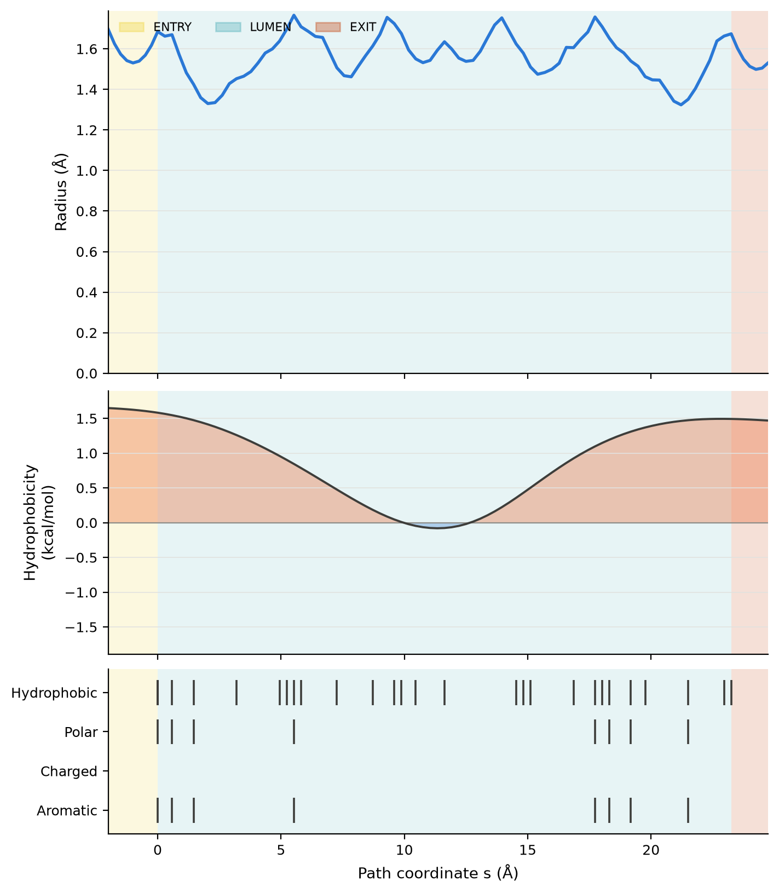

# Pore fingerprints

`crevice fingerprint` puts what CREVICE measures about a channel on one path
coordinate *s* (Å): the radius, how hydrophobic the residues lining the path
are, which kinds of residue line each part, the ENTRY / LUMEN / EXIT segments,
and, for an MD trajectory, the radius spread over frames and the water found
along the path. It also gives a geometric conductance estimate from the radius
profile.

Use it once `crevice profile` resolves the channel; it takes the same channel
options (`--axis`, `--origin`, `--enclosure-radius`, `--lateral-exits` ...).

:::{admonition} The conductance is an estimate, not a measurement
:class: warning

The conductance treats the pore as a tube filled with bulk electrolyte. It
ignores how ions interact with the wall, selectivity, dehydration and surface
charge, and bulk resistivity does not hold in a pore where ions pass in single
file. Read it as an order of magnitude. For gramicidin A it is about ten times
the measured conductance (see [Validation](#fingerprint-validation)).
:::

## Quick start

```bash
crevice fingerprint 1GRM --axis auto --out-dir 1GRM_fp --prefix 1GRM
crevice fingerprint 3UKM --assembly 1 --exclude-hetero --lateral-exits --enclosure-radius 0.55 \
    --out-dir 3UKM_fp --prefix 3UKM
crevice fingerprint glut1_excerpt.gro --trajectory glut1_excerpt.xtc \
    --selection 'protein and not name H*' --axis z --lateral-exits --enclosure-radius 0.55 \
    --out-dir glut1_fp --prefix glut1
crevice publish 1GRM --fingerprint --out-dir 1GRM_bundle     # the same files inside a publish bundle
```

```python
from crevice import load_structure
from crevice.fingerprint import fingerprint_structure, write_fingerprint_bundle

frame = load_structure(".crevice/pdb/1GRM.cif")
profile, cast, fp = fingerprint_structure(frame, axis="auto", electrolyte="kcl-1m")
print(fp.conductance["g_macro_pS"], [s["segment"] for s in fp.segments])
write_fingerprint_bundle(fp, "1GRM_fp", "1GRM")
```

For trajectories use {func}`crevice.fingerprint.fingerprint_trajectory`.

## What is measured

**Path coordinate *s*.** The lumen is the channel profile itself and runs
from 0 to its length *L* (the profile's axial coordinate, shifted to start at
0). Past each mouth the path follows one centre line out to bulk solvent. At an
open end this is the straight vestibule line used for the cast segments; at a
capped end (`--lateral-exits`) it is the widest lateral exit leg. These samples
sit at negative *s* (lower end) or beyond *L* (upper end), measured as path
length along that line. Any other exit legs are listed in the JSON with their
length and bottleneck, but they are not placed on *s*.

**Segments.** ENTRY and EXIT follow the same rule as `publish`'s cast segments
(`--entry-end`). They are geometric labels and do not imply a transport
direction.

**Radius.** In the lumen this is the profile radius. Along a vestibule or exit
leg it is the free-sphere clearance of the centre line. Both have
`--probe-radius` subtracted.

**Lining residues.** An atom lines a path sample when its van der Waals
surface is within `--lining-shell` (default 1.4 Å, one water radius) of the
largest atom-free sphere at that sample. Hydrogens, water and monatomic ions
are not counted. Each lining residue is anchored at the sample where it comes
closest.

**Hydrophobicity.** Each lining residue takes its value from the Wimley–White
whole-residue octanol scale (Wimley, Creamer & White 1996; White & Wimley
1999), with the sign reversed so that positive means hydrophobic (kcal/mol).
The profile is a Gaussian-weighted average of the residue values along *s*,
with a width set by `--hydrophobicity-bandwidth` (σ, default 3 Å). Each residue
counts once; CHAP uses the same kernel form. We chose the octanol scale because
it is measured for whole residues, covers both charged and neutral forms, and
describes moving into a low-dielectric environment, which is the contrast that
matters at a pore wall. Asp, Glu, Lys and Arg are taken as charged and His as
neutral. Protonation variants (HSD, HSP, ASH, GLH, ...) and D-amino acids
(DLE, DVA, ...) map to their parent residue. A residue-level scale cannot tell
when only the backbone faces the lumen: gramicidin A's pore is lined by
carbonyl oxygens of residues the scale calls hydrophobic.

**Chemistry.** Residues are classed as hydrophobic, polar, charged or aromatic
by {func}`crevice.radii.residue_properties`. A residue can fall into several
classes (Tyr is hydrophobic, polar and aromatic). Gly, ligands, lipids and caps
are counted as `other`. The counts are given per segment.

**Water (trajectories).** Every frame is fitted to the first frame, and the
radius is measured again at the fixed reference path samples. Each water
oxygen is assigned to its nearest path sample, using periodic imaging and the
same fit, and is counted if it lies inside that frame's free sphere at the
sample. Reported per sample: the mean count, the linear density (molecules per
Å), the number density (Å⁻³; bulk water is about 0.033 Å⁻³) and the occupancy
(the fraction of frames with at least one water). A free sphere is smaller
than a wide, non-circular cross-section, so these numbers are lower bounds.

**Conductance** (lumen only). This is the HOLE estimate (Smart et al. 1993,
1997): *G*<sub>macro</sub> = 1 / (ρ ∫ ds / πr(s)²), integrated with the
trapezoid rule. ρ is the bulk resistivity: 0.532 Ω m for 150 mM KCl by
default (`--electrolyte kcl-150mm|nacl-150mm|kcl-1m|nacl-1m`, or
`--resistivity`). Two other values are also reported:

- *G*<sub>access</sub> adds the access resistance ρ/(4a) at each mouth, where
  *a* is the mouth radius (Hall 1975; Hille 2001).
- *G*<sub>HOLE-corrected</sub> = *G*<sub>macro</sub> / 5.594. This is the
  constant empirical divisor in HOLE 2.3.1, which was calibrated on eight
  channels in 1 M KCl. It is shown for orientation only.

A zero radius anywhere in the lumen gives *G* = 0.

## Outputs

| File | Contents |
|---|---|
| `PREFIX_fingerprint.csv` | One row per path sample: `s_A`, `segment`, `source`, `t_A`, `x_A/y_A/z_A`, `radius_A`, `raw_clearance_A`, `hydrophobicity_kcal_mol`, `hydrophobicity_support`, lining counts per class and the nearest lining residue. Trajectories add `radius_mean_A`, `radius_sd_A`, `radius_q_low_A`, `radius_q_high_A`, `water_count_mean`, `water_linear_density_per_A`, `water_number_density_per_A3` and `water_occupancy` |
| `PREFIX_fingerprint.json` | Conductance with its assumptions and citations, segment chemistry and residue lists, every lining residue, exit legs and parameters; for trajectories, per-frame conductance statistics and water definitions |
| `PREFIX_fingerprint_frames.csv` | Trajectories: time, fit RMSD, lumen minimum radius, *G*<sub>macro</sub>, *G*<sub>access</sub> and the number of lumen waters in each frame |
| `PREFIX_fingerprint.png` | Stacked panels against *s*: radius (frame mean and quantile band for trajectories), hydrophobicity (orange above zero, blue below), water (trajectories) and a chemistry strip with one row per class. ENTRY is shaded yellow, LUMEN teal and EXIT rust. Titles and the conductance call-out appear only with `--annotate` |



(fingerprint-validation)=
## Validation

The software tests (`tests/test_fingerprint.py`) check the following on
synthetic inputs:

- a cylinder of known radius gives exactly the analytic integral *L*/(π*a*²)
  and HOLE's 1200/F pS convention;
- a wall of Leu rings at one end and Asp rings at the other gives a positive
  then negative hydrophobicity profile, with the expected values;
- lateral-leg samples sit at negative *s* with the right segment labels, and
  the labels swap with `--entry-end`;
- water oxygens are assigned to samples correctly.

These are checks of the software, not a validation against real systems.

On gramicidin A (1GRM), CREVICE gives *G*<sub>macro</sub> ≈ 390 pS for ρ =
1/12 Ω m (HOLE's 1 M KCl value) with the default radii, and 318 pS with the
HOLE radius set. HOLE 2.3.1 run on the same structure gives 280 pS. Its
integration runs past the mouths to a 5 Å end radius, so its geometric factor
is larger. With the HOLE correction, CREVICE gives 57–70 pS. The measured
single-channel conductance of gramicidin A in 1 M salt is about 10–30 pS, so
the uncorrected value is about 10–40 times too high and the corrected value
2–7 times too high. This is the overestimate Smart et al. (1997) describe, and
the reason the number is reported only as an order-of-magnitude estimate.

## Limitations

- Lining hydrophobicity is assigned per residue, so it cannot tell a
  backbone-lined lumen from a side-chain-lined one, and it ignores
  protonation-state changes beyond the residue names.
- Only one exit leg per end is placed on *s*.
- In trajectories the path is fixed at the reference frame and the lining
  residues are those of the reference frame; neither is resolved again in each
  frame.
- The water counts use free spheres, so they are lower bounds in wide or
  non-circular parts of the pore.
- The conductance values are geometric estimates (see the warning above).

## References

- Wimley WC, Creamer TP, White SH (1996) *Biochemistry* 35:5109–5124.
- White SH, Wimley WC (1999) *Annu Rev Biophys Biomol Struct* 28:319–365.
- Smart OS, Goodfellow JM, Wallace BA (1993) *Biophys J* 65:2455–2460.
- Smart OS, Breed J, Smith GR, Sansom MSP (1997) *Biophys J* 72:1109–1126.
- Hall JE (1975) *J Gen Physiol* 66:531–532.
- Hille B (2001) *Ion Channels of Excitable Membranes*, 3rd ed., Sinauer.
- Klesse G, Rao S, Sansom MSP, Tucker SJ (2019) CHAP: a versatile tool for the
  structural and functional annotation of ion channel pores. *J Mol Biol*
  431:3353–3365.
